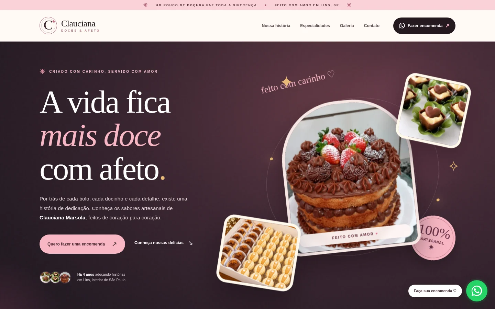
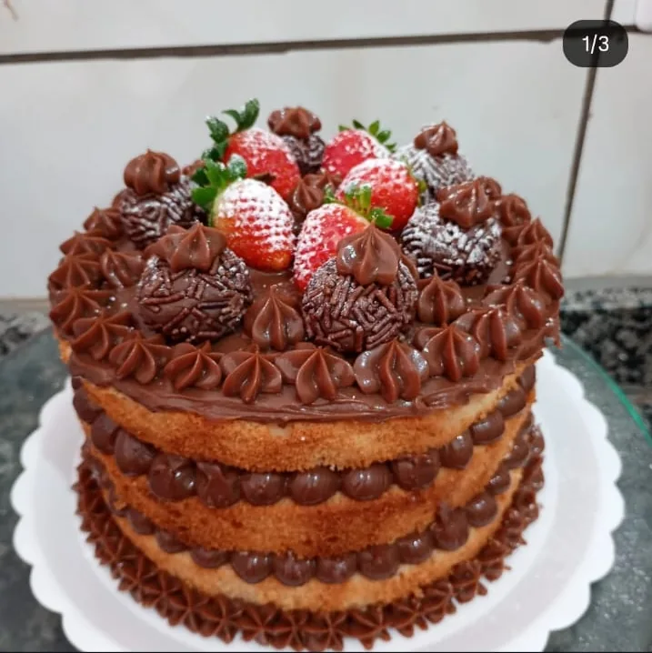
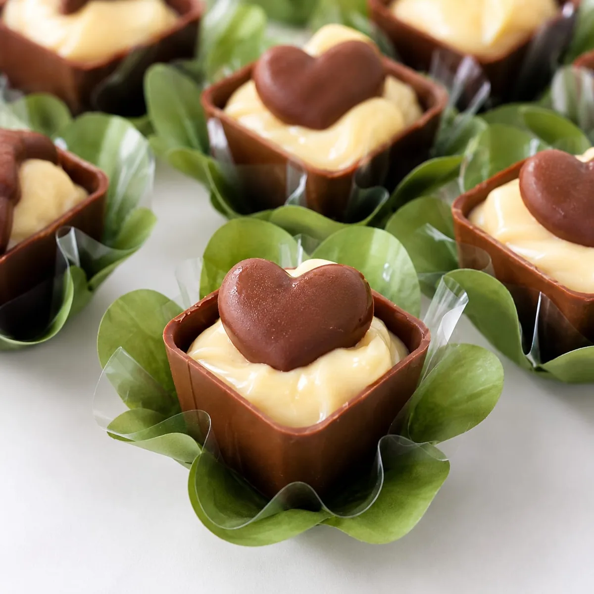
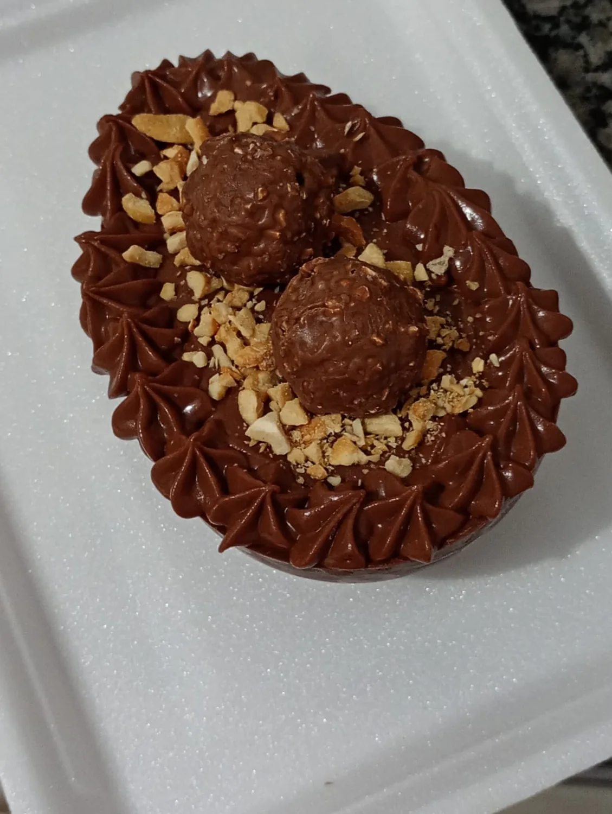
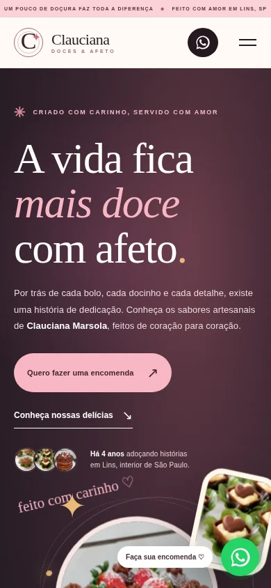

<div align="center">

# Clauciana · Doces & Afeto 🍰

### Cada doce carrega uma história. Cada detalhe, um pouco de amor.

**Um site-vitrine para valorizar o trabalho de uma confeiteira independente de Lins, São Paulo.**

Uma experiência visual delicada, com fotografias reais, profundidade em 3D e um caminho simples entre se apaixonar por um doce e conversar com quem o faz.

[**💬 Fazer uma encomenda**](https://wa.me/5514997074108?text=Ol%C3%A1%2C%20Clauciana%21%20Conheci%20seu%20site%20e%20gostaria%20de%20fazer%20uma%20encomenda.) · [**📷 Instagram**](https://www.instagram.com/claucianamarsola/) · [**📖 Conhecer o projeto**](#-sobre-o-projeto)



<sub>Prévia da página inicial no computador. Imagem do próprio projeto, hospedada neste repositório.</sub>

</div>

---

## 💗 Para quem este site foi criado?

Este projeto foi desenvolvido **para Clauciana Aparecida**, uma mulher batalhadora que, há cerca de quatro anos, começou a trilhar seu caminho na confeitaria artesanal.

Entre desafios, altos e baixos, aprendizado e muito trabalho, ela seguiu em frente, aperfeiçoando receitas, apresentações e técnicas. Hoje, cada bolo e cada docinho representa um pedacinho dessa trajetória construída com dedicação.

O objetivo não era criar apenas um catálogo bonito. Era **dar visibilidade ao talento de Clauciana, contar sua história e ajudar novos clientes a conhecerem seu trabalho**.

> **Não é só sobre doces. É sobre transformar esforço, cuidado e criatividade em momentos especiais.**

📍 **Atendimento em Lins, São Paulo** · 📷 **[@claucianamarsola](https://www.instagram.com/claucianamarsola/)**

## ✨ Sobre o projeto

**Clauciana · Doces & Afeto** é uma landing page institucional e portfólio fotográfico de confeitaria. O visitante conhece a profissional, explora diferentes tipos de produtos e pode iniciar uma conversa diretamente pelo WhatsApp.

O site foi criado para ser **leve, responsivo e fácil de manter**, sem banco de dados, contas de usuários ou etapas de compra complicadas.

### O que o visitante encontra

- **Apresentação envolvente:** destaque para as criações da Clauciana com composição visual em perspectiva 3D.
- **História da confeiteira:** uma seção humana, dedicada à sua jornada e ao cuidado por trás de cada encomenda.
- **Vitrine de especialidades:** bolos artesanais, doces finos e criações de Páscoa.
- **Galeria de fotos reais:** categorias, filtros e visualização ampliada das imagens.
- **Encomenda pelo WhatsApp:** botões em diferentes seções, incluindo um atalho flutuante. As mensagens já chegam preenchidas conforme o interesse do visitante.
- **Integração com Instagram:** acesso ao perfil para acompanhar mais trabalhos.
- **Experiência adaptada ao celular:** layout responsivo e efeitos que respeitam a preferência por movimento reduzido.

## 📸 Um pedacinho das criações

<div align="center">
  
  
  
</div>

<div align="center">
  <sub>Bolos artesanais • Doces finos • Especiais de Páscoa</sub>
</div>

### Também pensado para quem acessa pelo celular

<div align="center">
  
</div>

## 🛠️ Tecnologias utilizadas

| Tecnologia | Utilização |
| :-- | :-- |
| **HTML5** | Estrutura semântica do site e metadados |
| **CSS3** | Identidade visual, responsividade, transições, animações e efeitos de perspectiva 3D |
| **JavaScript (Vanilla)** | Galeria, filtros, modal de fotos, menu móvel e links de encomenda |
| **WebP** | Fotografias otimizadas para carregamento mais leve |
| **Google Fonts** | Tipografia da interface, com fontes alternativas configuradas |
| **GitHub + Vercel** | Versionamento e publicação do site estático |

**Por que sem React ou backend?** Porque, para este projeto, simplicidade também é qualidade: o conteúdo pode ser publicado como arquivos estáticos, sem servidor de aplicação e sem custo com banco de dados.

## 🗂️ Estrutura do projeto

```text
clauciana-doces-e-afeto/
├── index.html                # Página principal
├── styles.css                # Estilos, layout e efeitos 3D
├── script.js                 # Galeria, interações e WhatsApp
├── favicon.svg               # Ícone do site
├── assets/                   # Fotografias reais em WebP
├── docs/
│   ├── preview-desktop.webp  # Captura para o README
│   └── preview-mobile.webp   # Captura da versão móvel
└── README.md                 # Documentação
```

**🌐 Site online:**  `https://claucianadoces-orcin.vercel.app/` 

## 🤍 Sobre as encomendas e as imagens

O site **não realiza pagamentos nem confirma pedidos automaticamente**. Valores, detalhes, disponibilidade e prazos são combinados diretamente com Clauciana pelo WhatsApp.

As fotografias retratam trabalhos reais enviados para a criação do projeto. O uso dessas imagens deve ocorrer com a autorização da proprietária.

## 👩‍💻 Desenvolvimento

Projeto idealizado e desenvolvido com carinho para apoiar o negócio familiar de **Clauciana Aparecida**.

**Desenvolvimento:** [Sara Marsola](https://github.com/MarsolaSara)  
**Confeitaria e criações:** [Clauciana · @claucianamarsola](https://www.instagram.com/claucianamarsola/)  
**Localização:** Lins, São Paulo, Brasil

---

<div align="center">

### Feito para celebrar quem transforma dedicação em doçura. ♡

**Clauciana · Doces & Afeto**

</div>
